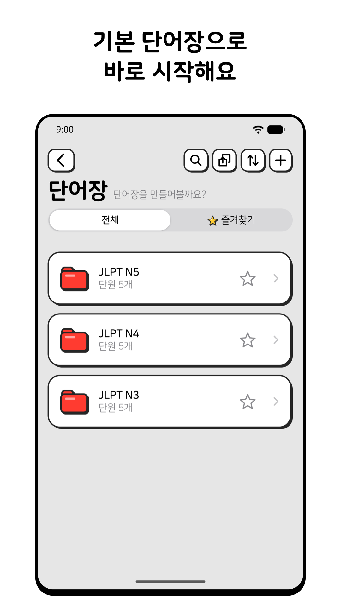
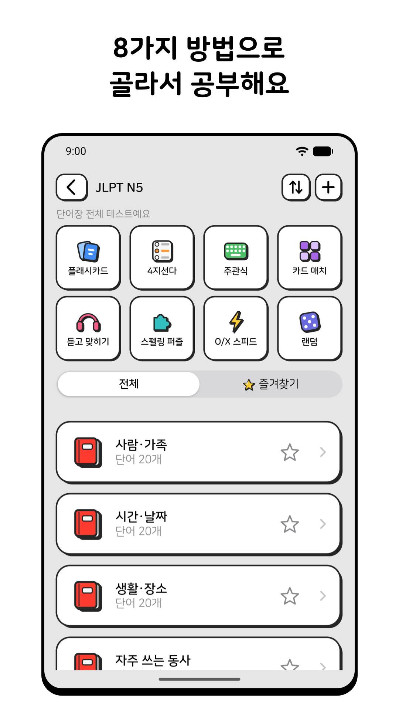
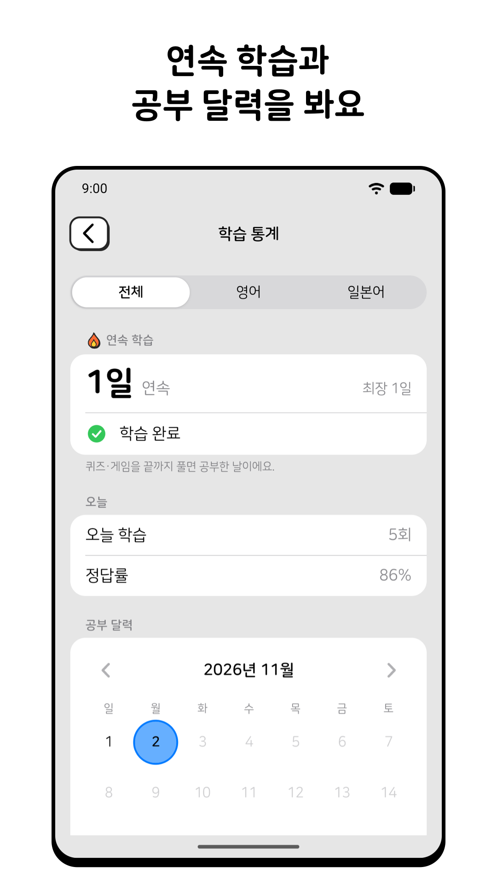

#  단어장

일본어·영어 단어를 퀴즈와 게임으로 외우는 단어장

계정을 만들지 않아도 되고, 단어 추가부터 퀴즈까지 인터넷 없이 할 수 있어요.

  

## 할 수 있는 것

- **기본 단어장:** JLPT N5·N4·N3 수준 300개, TOEIC 초급 수준 100개가 처음부터 들어 있어요.
- **내 단어 넣기:** 직접 입력하거나, 여러 줄을 붙여 넣거나, 단어장 사진에서 불러와요.
- **8가지 공부 방법:** 플래시카드, 4지선다, 주관식, 카드 매치, 듣고 맞히기, 스펠링 퍼즐, O/X 스피드, 랜덤
- **학습 통계:** 연속 학습 일수, 공부 달력, 정답률을 보고 자주 틀리는 단어를 복습해요.
- **백업 파일:** 단어와 학습 기록을 새 휴대폰으로 옮겨요. 아이폰과 안드로이드끼리도 돼요.

## 지금 상태

- **안드로이드:** Google Play 비공개 테스트 중이에요.
- **아이폰:** 아직 출시 전이에요.

## 개인정보

단어와 학습 기록은 휴대폰 안에 저장돼요. 광고가 없고, 단어를 서버로 보내지 않아요. 자세한 내용은 [개인정보처리방침](https://iamcode7.github.io/WordApp/)에 있어요.

## 문의

iamcode04@gmail.com
